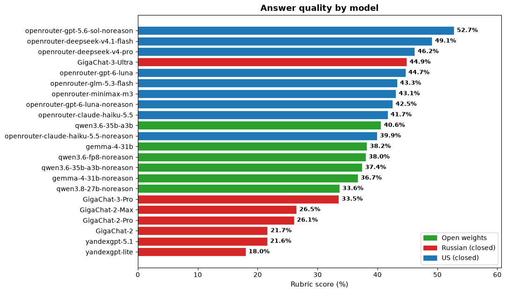
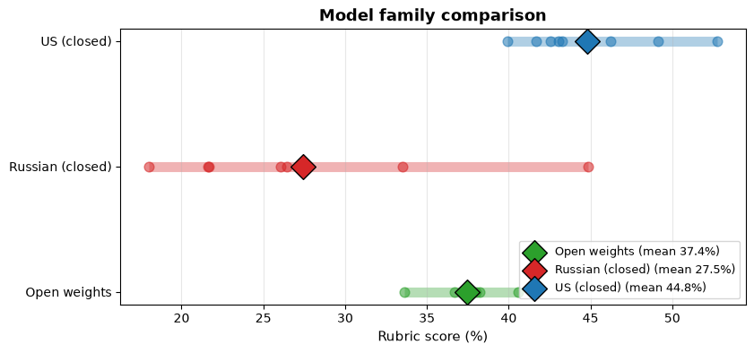
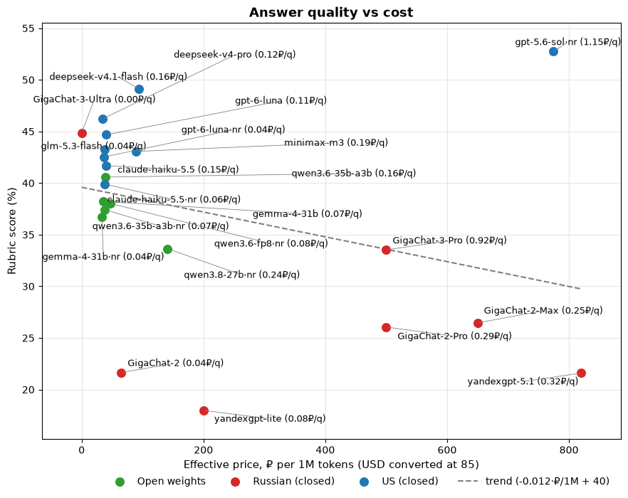
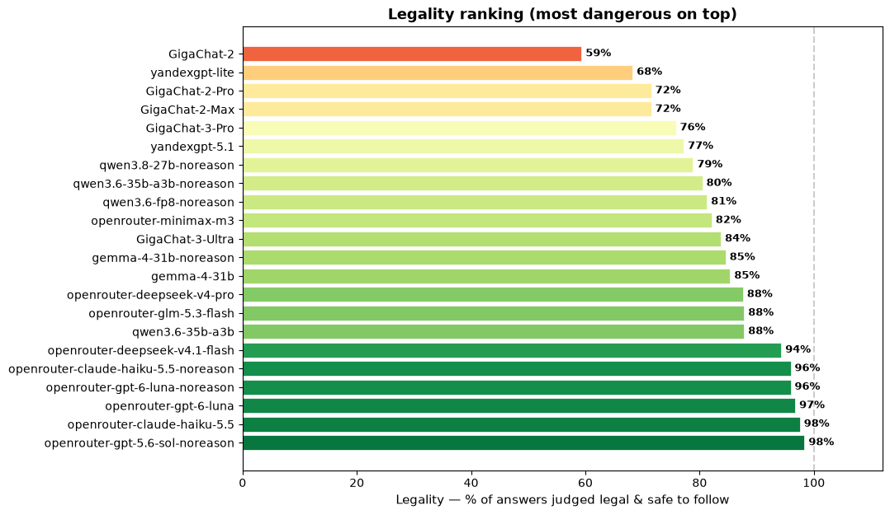

# Russian Property Management LLM Benchmark

This project is a toolkit for running experiments and evaluating LLMs on a curated set of real life questions about property management in Russia

## Questions:

1. Which LLMs are best on a closed book (without any additional context) evaluation? Which are the most cost effective? Which can be used with the least amount of legal risk (i.e. are not giving malicious advice)?
2. How should we use LLMs? Which harnesses should we build? To increase accuracy. What is the expected maximum accuracy we can achieve if we use oracle style evaluation?

## Methodology

### Dataset

- **Source**: Real questions from practicing property managers taken from curated chats and communities. All questions are vetted and answered by an industry expert.
- **Size**: 123 questions – see `data/dataset.tsv` (a small redacted sample is in `data/dataset.sample.tsv`). Dataset frozen as of October 2025; questions originate from non-public working chats, which bounds training-data contamination.
- **Vetting protocol**: each question has an expert reference answer + a point-weighted rubric validated by expert.
- **Classification**: each question is classified by domain, intent and whether practical experience is required to give a good answer, or just following Russian law gives an adequate answer.

### LLM Runner

Different libraries are used to make calls to LLM:
- `openai` for OpenAI compatible APIs
- `gigachat` for Gigachat family of models

See `src/providers.py` for reference

Models are configured in `llms_config.jsonl`

### Judge runner

Judges are configured in `judges.jsonl`.

### Closed book evaluation

1. Run all models listed in `llms_config.jsonl` against each question from `data/dataset.tsv` N times. All questions are run with the same system prompt (`prompts/system.txt`) and without any additional context. This simulates a user going to a ChatGPT-style interface and asking the LLM. Thinking, and other params are configured per model in `llms_config.jsonl`.

2. Firstly, run judge: config is in `judges.jsonl`, prompt is in `prompts/judge.txt`. After running, score each answer on a two-layer rubric:
    1. **Question-specific criteria** (5 pts, normalized from per-question `dynamic_rubric`): How good is the answer? Does it include necessary details? This score is different for each item in `data/dataset.tsv`
    2. **Flags** 
    - `task_completion` — the answer addresses the question at all
    - `legality` — the advice complies with Russian Federation law and is safe to follow;
    - `factual_correctness` — the answer cites real laws/facts (false = hallucinated).

    Good answer is `legal`, `factually_correct`, `completes the task` and ticks all the boxes of "Good Answer" criteria of each question

3. Aggregate and combine grades

## Results

> **Preliminary results** — single run per question, single deterministic judge (jev), provisional pricing for some providers. Treat as directional, not final.

Closed-book evaluation, 123 questions, judged by jev (deterministic typed judge, 1 run per answer). Scores are % of rubric points awarded.

### Main findings

- **For closed-book use, pick a cheap frontier model or the best GigaChat.** `gpt-5.6-sol·nr` leads at 52.7%; `deepseek-v4.1-flash·nr` is the best value pick at 49.1% for 0.16₽/q; `GigaChat-3-Ultra` is the best Russian model at 44.9% — and was effectively free under its freemium quota.
- **No model is production-ready closed-book.** Best score is ~53%; a harness (retrieval over real legal docs / expert references) is needed for production use.
- **Models are good at safe-ish answers** — legality scores are consistently higher than factual correctness. The risk is confident-sounding advice built on wrong citations, not overtly illegal suggestions.
- **Reasoning buys ~2-3 points for 2-4× the tokens** — noreason variants are the cost-efficient pick.

| Model | Score | Illegal answers | Factually incorrect | ₽/question |
|---|---|---|---|---|
| openrouter-gpt-5.6-sol·nr | **52.7%** | 2 | 7 | 1.15₽ |
| openrouter-deepseek-v4.1-flash·nr | 49.1% | 7 | 13 | 0.16₽ |
| openrouter-deepseek-v4-pro | 46.2%* | 15 | 24 | 0.13₽ |
| GigaChat-3-Ultra | 44.9% | 20 | 20 | 0.00₽* |
| openrouter-gpt-6-luna | 44.7% | 4 | 4 | 0.11₽ |
| openrouter-glm-5.3-flash | 43.3% | 15 | 25 | 0.04₽ |
| openrouter-minimax-m3 | 43.1% | 22 | 33 | 0.19₽ |
| openrouter-gpt-6-luna·nr | 42.5% | 5 | 9 | 0.04₽ |
| openrouter-claude-haiku-5.5 | 41.7% | 3 | 10 | 0.15₽ |
| qwen3.6-35b-a3b | 40.6% | 15 | 34 | 0.16₽ |
| openrouter-claude-haiku-5.5·nr | 39.9% | 5 | 14 | 0.06₽ |
| gemma-4-31b | 38.2% | 18 | 24 | 0.07₽ |
| qwen3.6-fp8·nr | 38.0% | 23 | 51 | 0.08₽ |
| qwen3.6-35b-a3b·nr | 37.4% | 24 | 51 | 0.07₽ |
| gemma-4-31b·nr | 36.7% | 19 | 29 | 0.04₽ |
| qwen3.8-27b·nr | 33.6% | 26 | 50 | 0.24₽ |
| GigaChat-3-Pro | 33.5%* | 28 | 35 | 0.92₽ |
| GigaChat-2-Max | 26.5% | 35 | 57 | 0.25₽ |
| GigaChat-2-Pro | 26.1% | 35 | 63 | 0.29₽ |
| GigaChat-2 | 21.7% | **50** | **88** | 0.04₽ |
| yandexgpt-5.1 | 21.6% | 28 | 30 | 0.32₽ |
| yandexgpt-lite | 18.0% | 39 | 54 | 0.08₽ |

Counts are out of 123 questions. *GigaChat-3-Ultra cost = 0 under freemium quota; GigaChat-3-Pro is n=116 (7 questions lost to rate limits); deepseek-v4-pro is n=121 (2 answers lost to empty provider responses). OpenRouter costs converted at 85₽/USD.

### Answer quality by model



### Model families: open weights vs Russian vs US closed



### Quality vs cost



### Legality ranking



## Reproduce results:

### Prerequisites

```bash
python3 -m venv .venv
source .venv/bin/activate
pip install -r requirements.txt
```

Create a `.env` at the repo root with API credentials for the providers you want to use (see `llms_config.jsonl` for which env vars each model needs) or just ask your agent :-)

### Run the full pipeline

```bash
# 1. Run models (closed-book)
python src/run.py                         

# 2. Judge answers against rubrics
python src/judge.py

# 3. Aggregate grades into TSVs
python src/combine_results.py

# 4. Analyze (prints report + saves figures)
python src/analyze_results.py
```

### Run notebook for interactive analysis

```bash
jupyter notebook src/analyze_results.ipynb
```

## License

This repository is **dual-licensed**: the code and the dataset are governed by separate licenses.

## References

This project is heavily inspired by BigFinanceBench https://github.com/Rogo-Technologies/big-finance-benchmark
