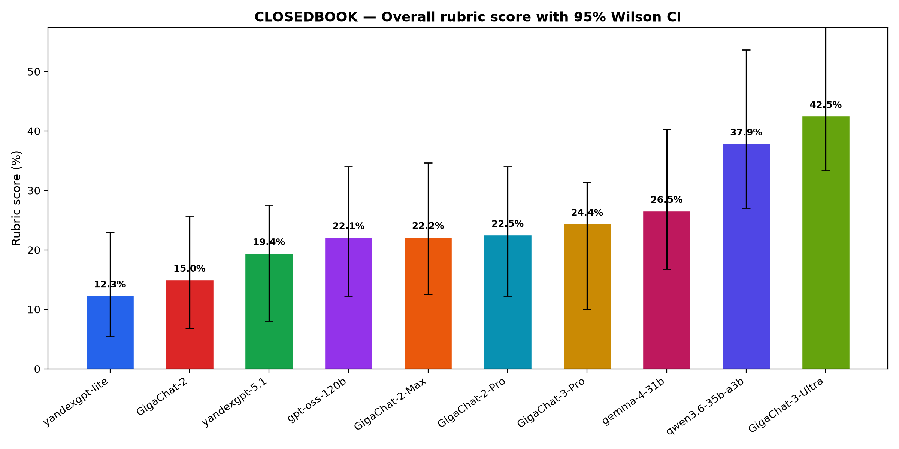
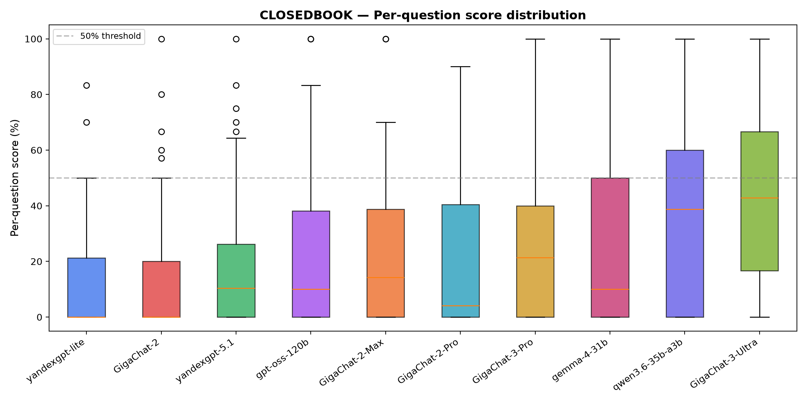
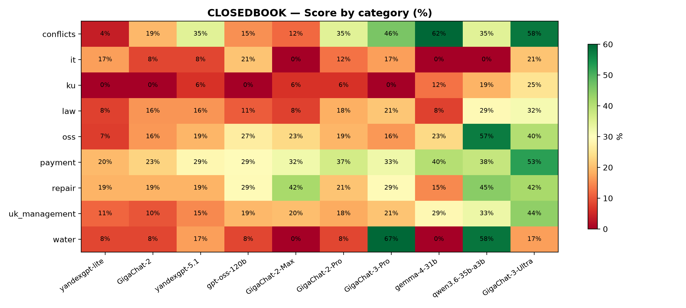
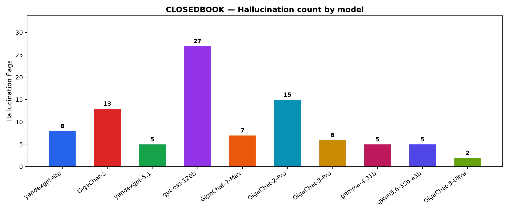

# Russian Property Management LLM Benchmark

This project is a scaffold for running experiments and evaluating LLMs on a curated set of real life russian questions about property management

## Questions:

1. Which LLMs are best on a closed book (without any additional context) evaluation?
2. If we were to provide all legal documents for each question. How would we increatse accuracy?
3. Which harness should we build to increase accuracy?

## Methodology

### Dataset

- **Source**: Real questions from practicing propety managers taken from curated chats and communities, All questions are vetted and answered by a practicing industry expert with 10+ yrs of experience.
- **Size**: 100–150 questions target; 50-question pilot for the MVP. Note that at the time only 8 questions are included in the public sample — see `data/dataset.sample.tsv`.
- **Vetting protocol**: each question has an expert reference answer + a point-weighted rubric (criterion lines)
- **Language**: Russian (questions and reference answers).

### Closed book evaluation

1. Take all questions from dataset and run all models listed in `llms_config.jsonl` against them. All questions are ran with the same system prompt (`prompts/system.txt`) and without any additional context. This simulates a user going to a ChatGPT-style interface and asking the LLM. Thinking, temperature and other params are configured per model.
2. Run judge (config specified in `judges.jsonl`, prompt in `prompts/judge.txt`) against the model answers. The judge scores each answer on a two-layer rubric:
   - **Fixed dimensions** (5 pts, same for all questions): legal grounding (2), completeness (1), actionability (1), confidence (1).
   - **Question-specific factual criteria** (5 pts, normalized from per-question rubric): original expert-defined criteria, normalized to a fixed 5-pt scale so scores are comparable across questions.
   - **Total: 10 pts per question.** The judge also flags hallucinations (cited laws/articles that don't exist or are wrong).
3. Aggregate grades with `src/combine_results.py` (produces `results/grades_raw.tsv` and `results/grades.tsv`), then analyze with `src/analyze_results.py` or `src/analyze_results.ipynb`. Results are compared on: overall score (% of max), per-category breakdown, score distribution, hallucination rate, token cost, and latency.

## Results

Current closed-book results (52 questions, judged by `qwen3.6-35b-a3b`, run 0):

| Model | Score | Pct | 95% CI | Tokens | Cost ($) | Halluc | N |
|---|---|---|---|---|---|---|---|
| GigaChat-3-Ultra | 110/260 | 42.5% | 33.3–59.5% | 54,873 | 0.00 | 2 | 52 |
| qwen3.6-35b-a3b | 89/235 | 37.9% | 27.0–53.7% | 201,620 | 7.88 | 5 | 48 |
| gemma-4-31b | 69/260 | 26.5% | 16.8–40.3% | 103,420 | 3.57 | 5 | 52 |
| GigaChat-3-Pro | 59/242 | 24.4% | 10.0–31.4% | 92,547 | 46.27 | 6 | 49 |
| GigaChat-2-Pro | 58/260 | 22.5% | 12.2–34.0% | 31,937 | 15.97 | 15 | 52 |
| GigaChat-2-Max | 56/255 | 22.2% | 12.5–34.6% | 21,231 | 13.80 | 7 | 51 |
| gpt-oss-120b | 58/260 | 22.1% | 12.2–34.0% | 132,839 | 2.50 | 27 | 52 |
| yandexgpt-5.1 | 50/260 | 19.4% | 8.0–27.5% | 21,330 | 8.53 | 5 | 52 |
| GigaChat-2 | 38/254 | 15.0% | 6.8–25.7% | 31,958 | 2.08 | 13 | 51 |
| yandexgpt-lite | 32/260 | 12.3% | 5.4–23.0% | 22,893 | 4.58 | 8 | 52 |

**Key findings:**
- **GigaChat-3-Ultra** – a Frontier Russian LLM leads at 42.5%, with the lowest hallucination rate (3.8%)
– **Yandexgpt** – another Frontier Russian LLM was worse on almost all occasions
- **gpt-oss-120b** has the highest hallucination rate (51.9%) — it invents legal citations in over half of answers.
- Even frontier **LLMs can not be trusted** running closed book style

### Overall scores



### Score distribution



### Category heatmap



### Hallucinations



## Reproduce

### Prerequisites

```bash
python3 -m venv .venv
source .venv/bin/activate
pip install -r requirements.txt
```

Create a `.env` at the repo root with API credentials for the providers you want to use (see `llms_config.jsonl` for which env vars each model needs):

```
OPENAI_API_KEY=...
OPENAI_API_BASE=...
YANDEX_API_KEY=...
YANDEX_FOLDER_ID=...
GIGACHAT_AUTH_KEY=...
GIGACHAT_CLIENT_ID=...
GIGACHAT_SECRET=...
```

### Run the full pipeline

```bash
# 1. Run models (closed-book)
python src/run.py                         

# 2. Judge answers against rubrics
python src/judge.py

# 3. Aggregate grades into TSVs
python src/combine_results.py

# 4. Analyze (prints report + saves figures)
python src/analyze_results.py
```

### Notebook

`src/analyze_results.ipynb` loads `results/grades.tsv` and provides interactive exploration: leaderboard, score distributions, per-category breakdowns, hardest/easiest questions, hallucination analysis.

```bash
jupyter notebook src/analyze_results.ipynb
```

## Repo layout

```
data/
  dataset.sample.tsv        # public sample: 8 questions with rubrics and expert answers
  LICENSE                   # dataset license (CC BY-NC-SA 4.0)
prompts/
  system.txt                # closed-book system prompt
  judge.txt                 # judge prompt (two-layer rubric)
src/
  run.py                    # run models on dataset
  judge.py                  # judge model answers against rubrics
  combine_results.py        # aggregate grade JSONLs into TSVs
  analyze_results.py        # console report + figures
  analyze_results.ipynb     # interactive notebook analysis
  llm.py                    # provider abstraction (OpenAI, GigaChat)
llms_config.jsonl           # model configurations (provider, pricing, params)
judges.jsonl                # judge configurations
results/                    # generated TSVs and figures (regenerable, raw JSONLs gitignored)
```

## License

This repository is **dual-licensed**: the code and the dataset are governed by separate licenses.

## References

This project is heavily inspired by BigFinanceBench https://github.com/Rogo-Technologies/big-finance-benchmark
